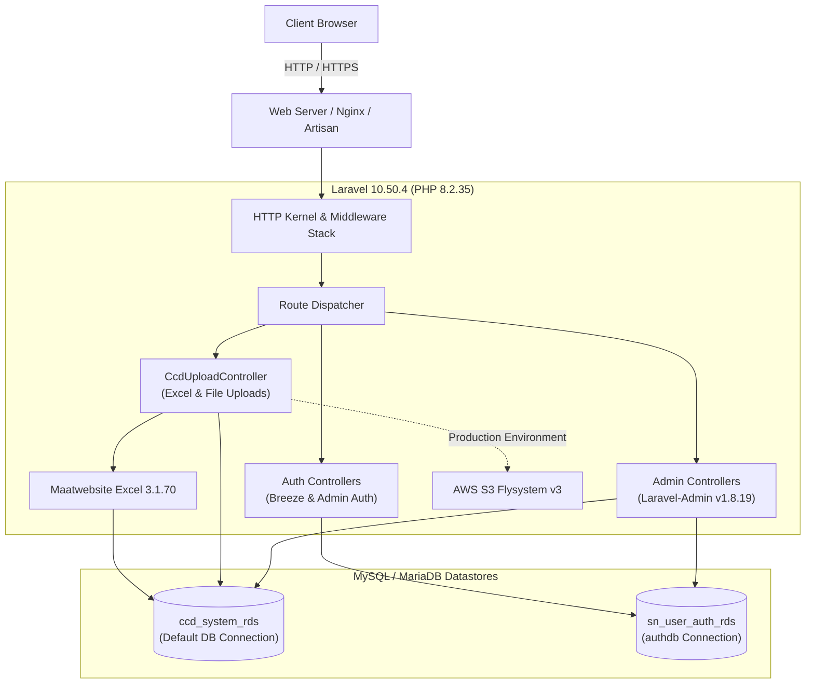
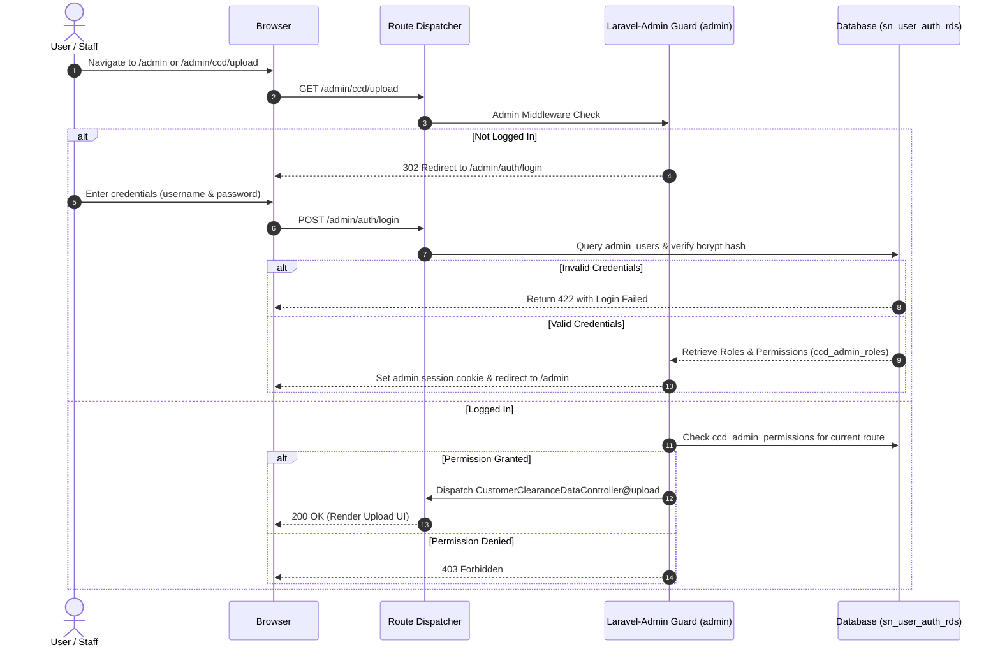
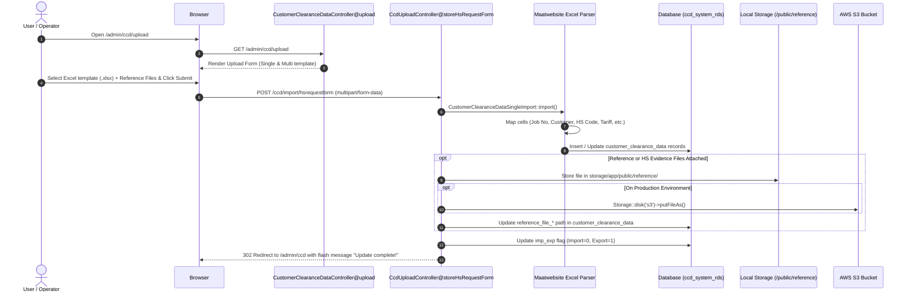
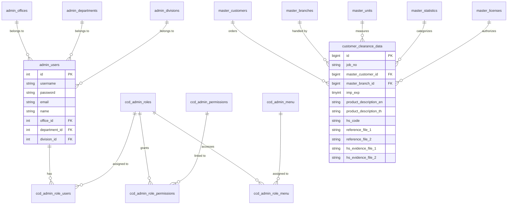

# CCD System Architecture & Technical Flowchart

This document illustrates the technical architecture, authentication workflows, file upload process, and database interactions of the CCD (Customer Clearance Data) application.

---

## 1. High-Level Technical Architecture

---

## 2. Authentication & RBAC Flow

---

## 3. HS Requisition Excel File Upload Flow

---

## 4. Multi-Database Data Mapping

